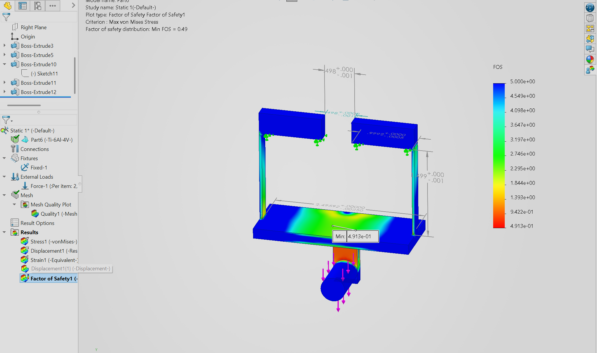
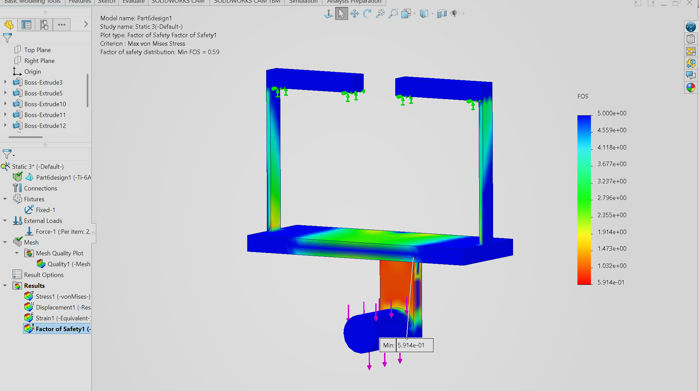
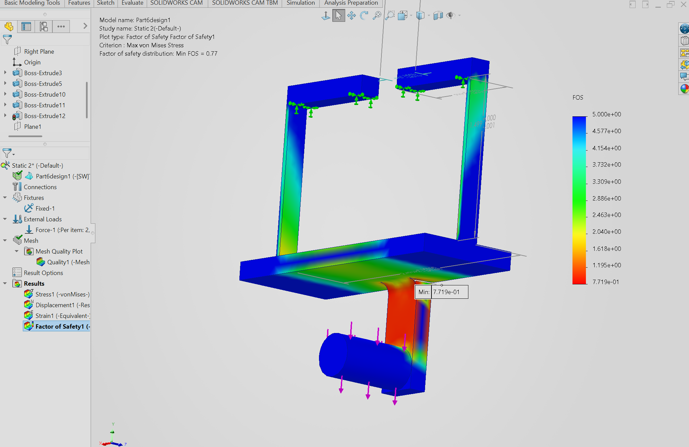
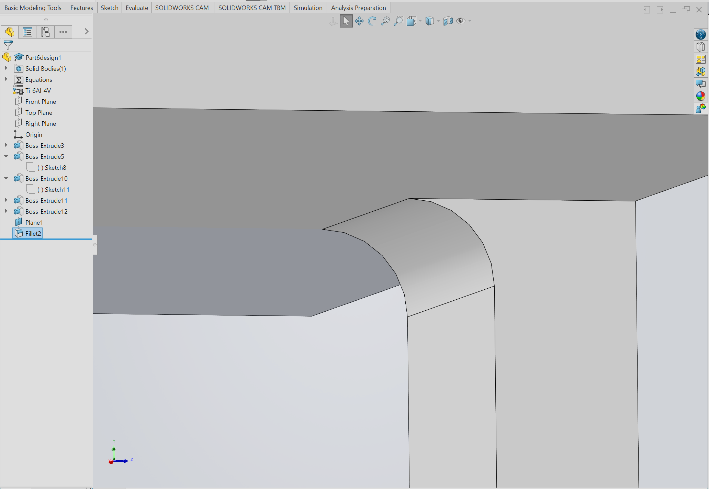
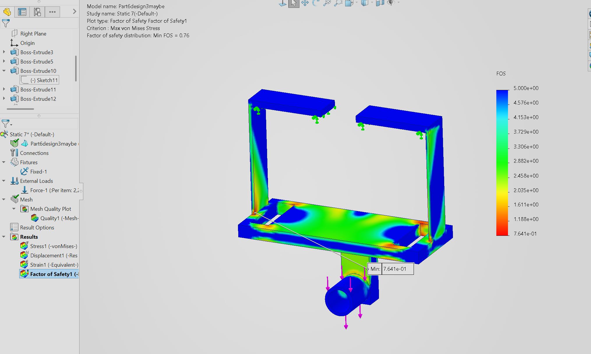
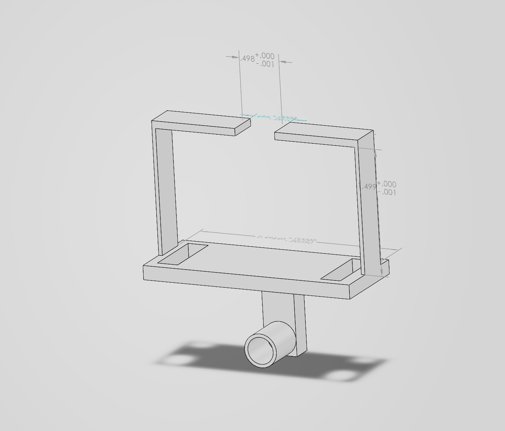
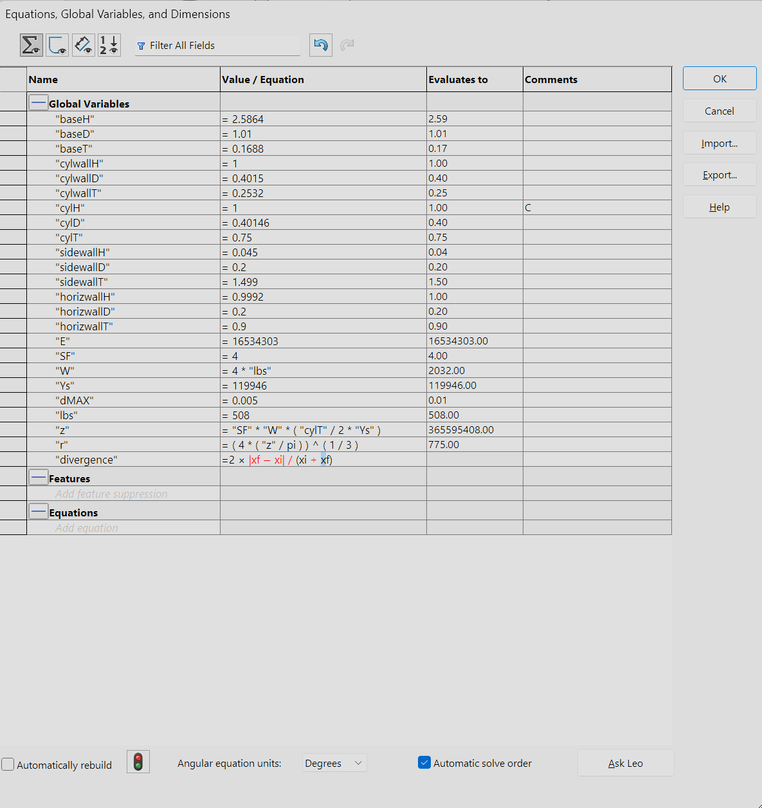
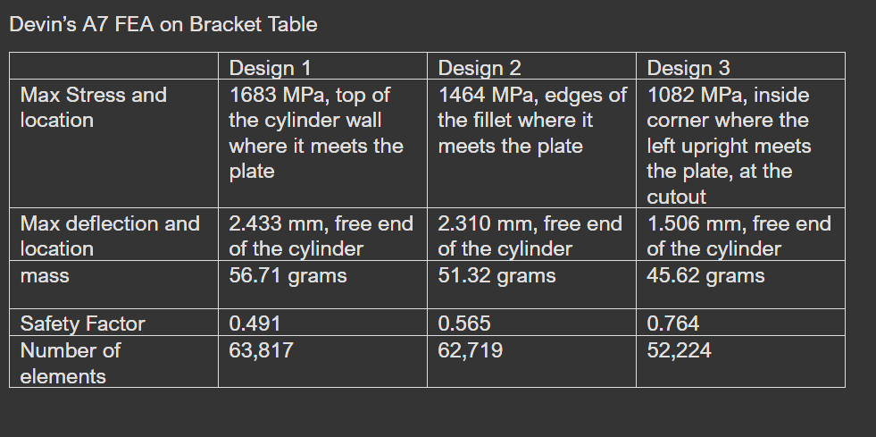
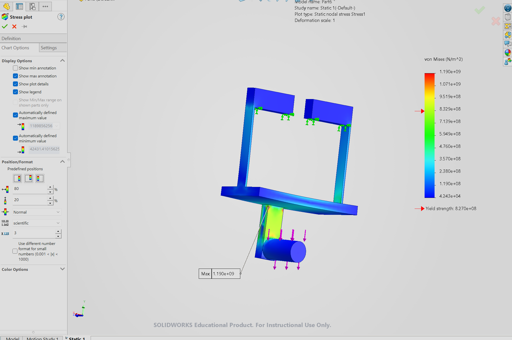

# A7 – FEA on Bracket

For this assignment the part previously designed in project A6 will be refined and optimized to cut unnecessary material using a "3x test 3x design" method. The material I chose for my bracket is Titanium (Ti-6Al-4V with yield of 827 MPa). The workflow for this project will consist of two parts. The first is an inner loop where the mesh will be changed up to three times(atleast two times), from coarser to finer until a 7% convergence appears validating the loop. The outer loop is where the actual geometry of the shape will be changed, removing material that is unnecessary and adding material where it could come in handy. The ultimate goal is to make the part be stronger, stiffer, and more lightweight than the prior iterations.

Below is an image of my initial part from A6:

**<u>Part 1: First FEA Design run</u>**

One of the goals I have for this project is to make it bend less. I think adding material will help, so I will try that first. I chose 508lbf for the A5, so I will continue using that for this which translates to ~2260N. This force will be consistently applied at face load to the outer cylinder face normal to the baseplate pointing down. The vertical bracket holders/hooks will be the fixtures.

Convergence Difference formula = 2 × |xf − xi| / (xi + xf) × 100%

Elements: tetrahedrons in the coarse to fine mesh

## __PART 1:__ <u>First FEA Design</u>

Things changed: made the baseplate and cylinder wall(the wall that is holding the cylinder) 4x thicker going from 0.0422 -> 0.1688in for both of them. 

 
 
Coarse Run 
Elements	4,521 Mass:	56.71 grams

Max stress	1190 MPa
Max deflection	2.387 mm (0.094 in)
Safety factor	0.695 (yield 827 MPa ÷ 1190 MPa)

Fine Run (convergence in 1->2)
Elements:	14,499 Mass:	56.71 grams

Max stress	1376 MPa (14.50% difference)
Max deflection	2.419 mm (0.095 in) (1.33% convergence)
Safety factor	0.601 (yield 827 MPa ÷ 1376 MPa) (14.47% difference)

Finest Run (convergence in 2->3)
Elements:	63,817 Mass:	56.71 grams

Max stress	1683 MPa  (20.07% difference)
Max deflection	2.433 mm (0.096 in) (0.58% convergence)
Safety factor	0.491 (yield 827 MPa ÷ 1683 MPa) (20.12% difference)

**<u>Thought Process</u>** The max stress	for each run was located at the top of the cylinder wall where it meets the plate, the "stress corner". The same happens with FOS. Max deflection	focused primarily at the free end of the cylinder

FINAL DATA on convergence. Was it below 7%? No, it wasn't. There was stress focal points on the corners of the cylinder wall which I believe contributed to the wide convergence.

## __PART 2:__ <u>Second FEA Design</u>

Things changed: I saw the stress locations and made the corners where stress was located fillet'ed and cut the horizontal bracket bars in half 0.356 -> 0.178in to reduce weight.

 

Coarse Run 
Elements	2,483 Mass:	51.32 grams

Max stress	1398 MPa
Max deflection	2.27 mm (0.089 in)
Safety factor	0.591 (yield 827 MPa ÷ 1398 MPa)

Fine Run (convergence in 1->2)
Elements:	11,347 Mass:	51.32 grams

Max stress	1466 MPa (4.75% convergence)
Max deflection	2.300 mm (0.090 in) (1.31% convergence)
Safety factor	0.564 (yield 827 MPa ÷ 1466 MPa) (4.68% convergence)

Finest Run (convergence in 2->3)
Elements:	62,719 Mass:	51.32 grams

Max stress	1464 MPa (0.14% convergence)
Max deflection	2.310 mm (0.091 in) (0.43% convergence)
Safety factor	0.565 (yield 827 MPa ÷ 1464 MPa) (0.18% convergence)

 
  

**<u>Thought Process</u>** The max stress appeared at the two edges of the fillet where it meets the plate, Max deflection	focused primarily at the free end of the cylinder. I must have reduced the stress point as convergence was very steady this run.

FINAL DATA on convergence. Was it below 7%? Yes! Everything ran smoothly, though the stress, deflection and safety factor are still a bit high for my liking. This is a stable build and a bit lighter than the first one.

## __PART 3:__ <u>Third FEA Design</u>

Things changed: I cut some rectangular spaces out from the areas of the bracket that were not under much stress. I also carved out a 0.32in diameter cylindrical hole in the cylinder and widened the cylinder wall to 0.2532 to reduce stress. I then halved the horizontal bracket bar again to ~0.09 for more weight savings. The final move was widening the vertical bracket walls from 0.2 to 0.4 and shortening the cylinder to fix the center of the weight more, shaving 0.25in off.

 

Coarse Run 
Elements	2,406 Mass:	45.62 grams

Max stress	831 MPa 
Max deflection	1.458 mm (0.057 in), 
Safety factor	0.995 (yield 827 MPa ÷ 831 MPa), 

Fine Run (convergence in 1->2)
Elements:	8,514 Mass:	45.62 grams

Max stress	904 MPa (8.41% difference)
Max deflection	1.495 mm (0.059 in) (2.51% convergence)
Safety factor	0.914 (yield 827 MPa ÷ 904 MPa) (8.41% difference)

Finest Run (convergence in 2->3)
Elements:	52,224 Mass:	45.62 grams

Max stress	1082 MPa (17.88% difference)
Max deflection	1.506 mm (0.059 in) (0.73% convergence)
Safety factor	0.764 (yield 827 MPa ÷ 1082 MPa) (17.91% difference)

**<u>Thought Process</u>** The max stress appeared on the two vertical bracket bars on the edges. A fillet could fix it but this is my last design. Max deflection	focused primarily at the free end of the cylinder again. Stress is lower and safety factor is higher, but all small problems become bigger once the large problem is out of the way(cylinder wall). The weight loss is small but exists.

FINAL DATA on convergence. Was it below 7%? Not close. I changed a lot of areas on the part, including gutting the plate and cylinder. Fillets may have helped a little with this, but I hadn't thought about it for this last one since i thought it was going to be very stable based on the first run. If I could go back I would make the vertical bars thicker as well, or make the fillets huge. 

# IMAGE OF GEN 3 PART:

 

HERE ARE THE PARAMETERS AND TABLE IF NEEDED:

## __PART 4:__ <u>Reflections</u>

This assignment was fun because it allowed me to feel the satisfaction of getting the rhythm down for simulation. I understand how to apply forces and fixtures and set parameters without needing to search a tutorial online. In terms of my designs, I realized 1 and 3 didn’t converge on stress because of sharp corners. Design 2 converged because its corners were filleted and reducing that big stress point contributed to its success. Deflection converged in every design which I thought was interesting. The improvement from Design 1 to Design 3 was fun to calculate. Stress down 36%, deflection down 38% and mass down 20%. It amazes me that computers can solve this stuff in seconds. Though the finer meshes did take a bit longer. My laptop fans didn't even turn on once. Overall it took me ~5 hours to complete this assignment. 

## Problems Faced

It was a learning process the entire way. I was scared my bracket wasn't built right as when I first tried to simulate the original A6 bracket (0.04 in plate), it failed to solve at full load with “equilibrium not achieved.” I found it was later due to the part not being able to support such a high force, as turning it down to 226N worked fine. Thats the biggest reason my first move in this project was thickening the baseplate and cylinder wall. I had trouble applying the force for the simulation properly, but I was able to watch a tutorial to properly set it up. In between design 2 and 3, I did a small test run to see whether my design would hold up despite being quite a bit lighter, and it did horribly with ~3.06mm deflection. The safety factor is the one thing I want to change. It is still below 1 and I feel like I could refine this bracket if I invested more time into it. Thickening the vertical walls and using fillet on the upright corners would probably ease the focused stress on that edge.

## FILES

Parts: 
[Design 1](Part6design1.SLDPRT)

[Design 2](Part6design2.SLDPRT)

[Design 3](Part6design3FINAL.SLDPRT)

