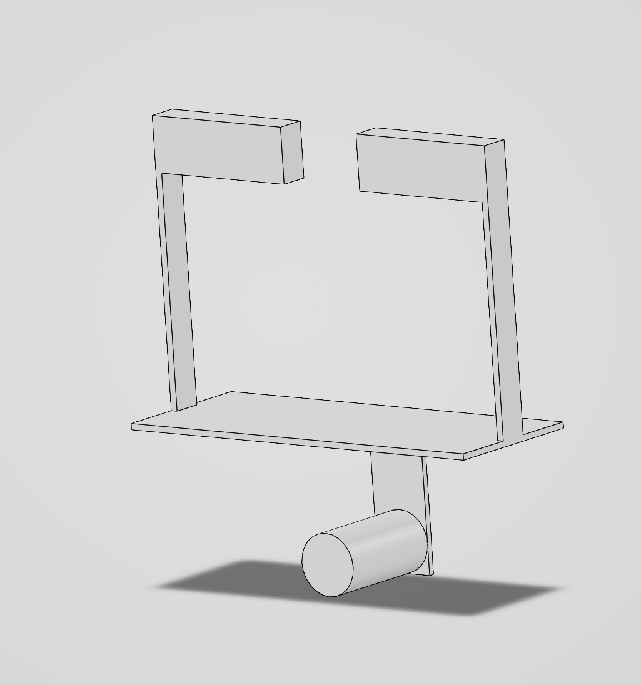

# A7 – FEA on Bracket

For this assignment the part previously designed in project A6 will be refined and optimized to cut unnecessary material using a "2x 3x" method. The material I chose for my bracket is Titanium (Ti-6Al-4V). The workflow for this project will consist of two parts. The first is an inner loop where the mesh will be changed up to three times(atleast two times), from coarser to finer until a 7% convergence appears validating the loop. The outer loop is where the actual geometry of the shape will be changed, removing material that is unnecessary and adding material where it could come in handy. The ultimate goal is to make the part be stronger, stiffer, and more lightweight than the prior iterations.

Below is an image of my initial part from A6:

**<u>First FEA run</u>**

One of the goals I have for this project is to make it bend less. I think adding material will help, so I will try that first. I chose 508lbf for the A5, so I will continue using that for this which translates to ~2260N. This will be consistent.

FEA: coarse-ness/fine-ness
image of fixture location:
I chose a face load over a line load or point load (it avoids stress "singularities" where its all in one spot)
Things changed: made the baseplate and cylinder wall 4x thicker going from 0.0422 -> 0.1688in for both of them. Elements: tetrahedrons in the coarse to fine mesh

Run 1! Elements	4,521 Mass:	0.13 lb
FEA data and image first mesh run
Max stress	1190 MPa at the top of the web where it meets the plate
Max deflection	2.387 mm (0.094 in), at the free end of the cylinder
Safety factor	0.695 (yield 827 MPa ÷ 1190 MPa), same location as max stress

Run 2! Elements:	14,499 Mass:	0.13 lb
FEA data and image Second mesh run 
Max stress	1376 MPa at the top of the web where it meets the plate, the stress corner.
Max deflection	2.419 mm (0.095 in), at the free end of the cylinder
Safety factor	0.601 (yield 827 MPa ÷ 1376 MPa), same location as max stress 

Run 3! Elements:	63,817 Mass:	0.13 lb
FEA data and image Second mesh run 
Max stress	1683 MPa at the top of the web where it meets the plate, the stress corner.
Max deflection	2.433 mm (0.096 in), at the free end of the cylinder
Safety factor	0.491 (yield 827 MPa ÷ 1683 MPa), same location as max stress 

Images:

## __PART 1:__ <u>Second FEA run and image</u>

**<u>Third FEA run and image</u>**

DATA ON HOW I DID IT ALONG THE WAY, INCLUDE MY SHORTCOMINGS

**<u>Thought Process</u>**
Give my thoughts on the previous section here

HERE ARE THE PARAMETERS:
Image of parameters here if needed)

## __PART 3:__ <u>Reflections</u>
 Reflection Statement

## Lessons Learned

Give lessons learned

## FILES

Parts: [the part ](Part6.SLDDRW)
Drawing: [the drawing](Part6.SLDPRT)

