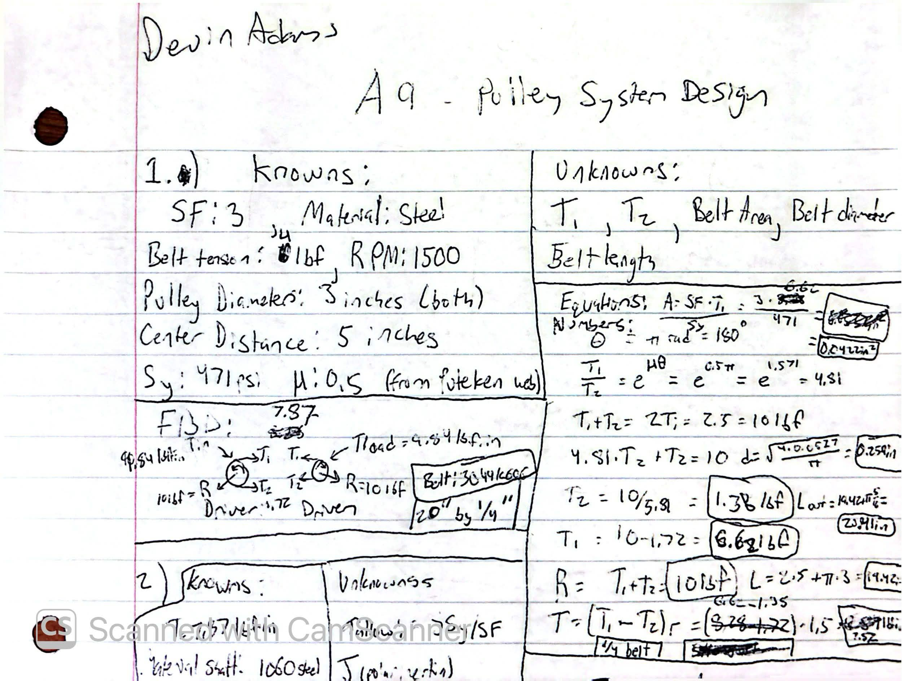
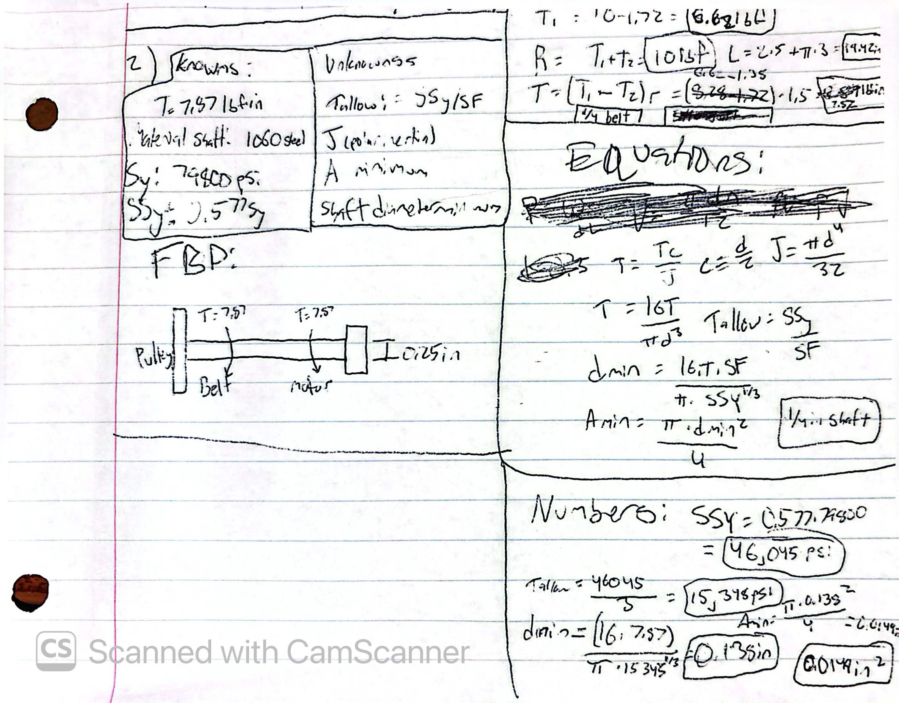
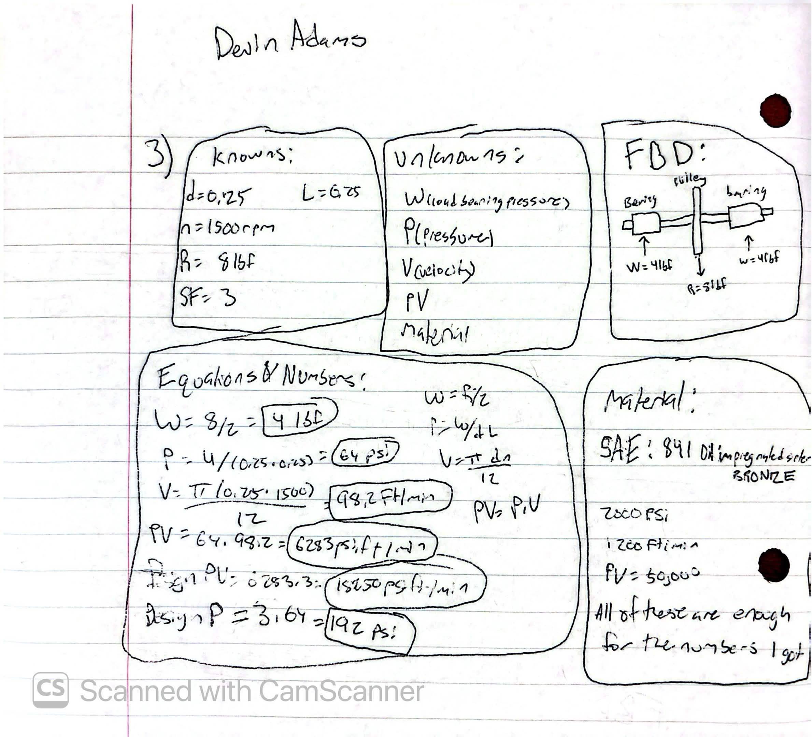
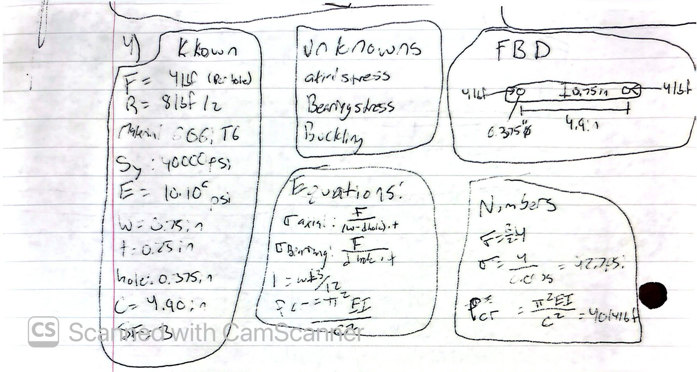
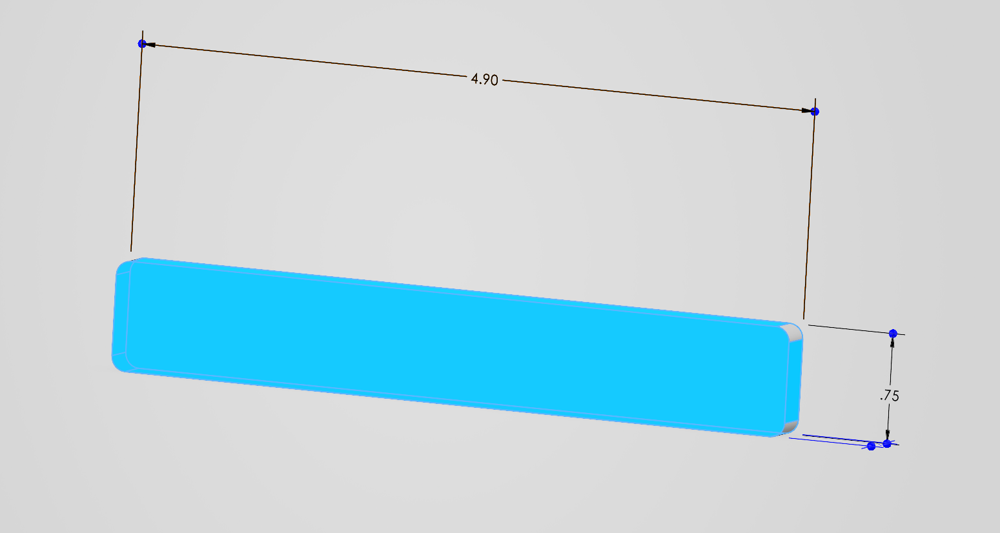
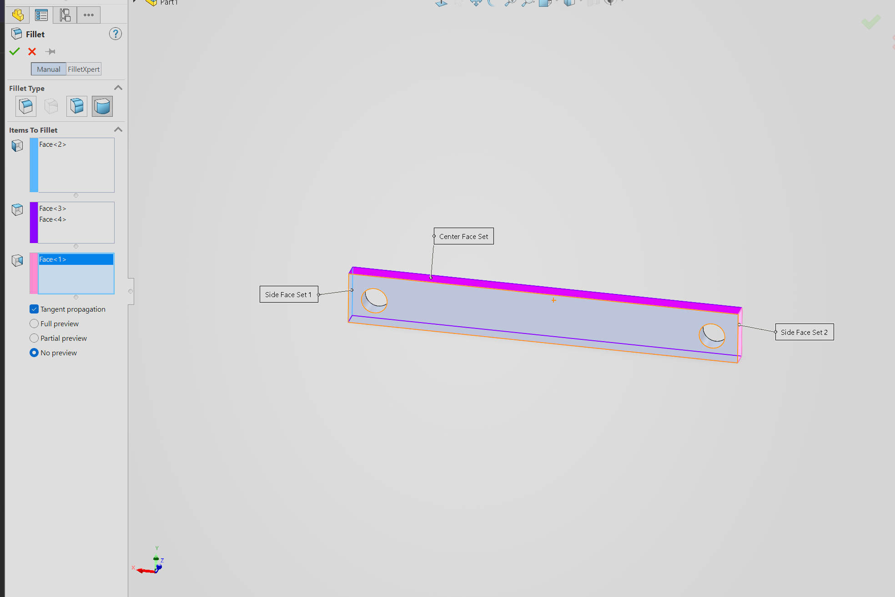
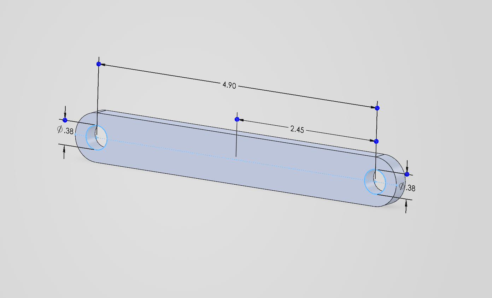
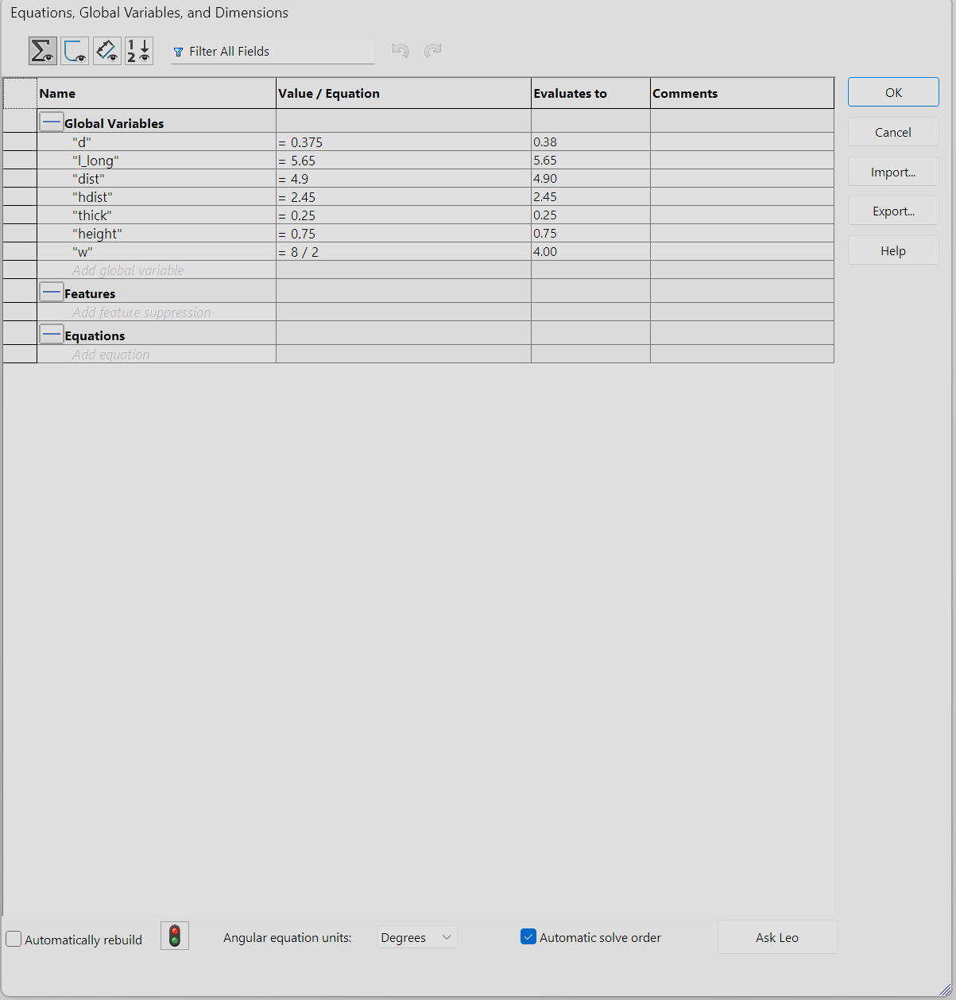

# A9 – Pulleys
This project revolves around designing a pulley system using friction calculations, static analysis, and dynamic analysis. The material of the pulleys are to be decided along with the belt tension of the polyurethane rubber belt(which will have its length and width decided). Using a safety factor of 3 and a center distance of 5 inches(later changed to 4.9 to better reflect my values), the factors of the belt design, shaft diameter, journal bearings and frame will be found with Handbook equations and free body diagrams. I will use solidworks to create the frame of the pulley. 

## **<u>Part 1: Belt Design</u>**

I decided on Steel for the material of the pulleys, and used the <u>Puteken</u> website linked at the bottom(which gave me 0.5) for the value of the polyurethane vs steel friction coefficient. I started off with 5/16" and 5lbf but these values changed because they did not work out realistically. It was not too difficult to figure out the values but it did take a little bit of time. I reorganized my calculations onto this page for more visibility of data. I had to redo the numbers after a bit when I realized that the belt I was looking to make did not exist on the McMasters website. It was a 5/16" x 20" belt, but they only had >24". I changed my variables and re-did the calculations and got new data which is visible on the image below. I ended up with 4lbf of belt tension a 1/4" x 20" belt part number "3044K606". The bearing part number is 6391K131.

## **<u>Part 2: Shaft's Diameter Design</u>**

For the shaft diameter design I found the yield strength value was ultimately not too important for the diameter calculation. Between 79,800-144,000psi there was a very small difference in the final value I got. This was for experimentation  purposes, adjusting the numbers to test how it will affect my variables. my minimum diameter was 0.138in and I went with a safe 0.25in. The last few times I used the minimum value for my variables my cad modeled bracket deflected a lot, though in this case the limiting factor would be torsion. I also chose it since it would be more likely to be in stock in that size rather than 0.138"

## __PART 3:__ <u>Journal Bearing Design</u>

When deciding on the journal bearings I chose an oil impregnated sintered bronze SAE 841 material. After having calculated the numbers there was plenty of margin in the safety factor and this was beneficial as I was able to use the same material of bearing from the previous project and I did not have to calculate the safety factors more than once. I chose this from Table 4 on p. 2440 and used McMaster Part number 3044K606 for the bearing

## __PART 4:__ <u>Design of Frame</u>

Here I calculated the values for my frame.

I decided on using Aluminum T6 as the material for the frame and it was interesting to see how far I've progressed when it comes to making parts. It might have taken me an hour to model this but today it took me 25 minutes. During this stage I still made a few mistakes. I had to learn how to use full round fillet to make the edges rounded all across instead of just the corners.   

Here is how I managed to properly fillet the left and right sides, by swapping to the full round fillet. Included during this stage I created a centerpoint guideline and placed the holes in my frame for the bearings 4.90" away from each other. Smart dimensioning with my parametric variables made it easy. 

Here's my final frame design, which came out optimally.  The file is linked at the bottom. 

## __PART 5:__ <u>Lessons Learned</u>
I learned a few lessons this time. The biggest one this time was making sure that the belt or part that you are looking to solve for exists. When I first started on this project I finished all of the calculations to find which belt I would want to use and when it came to actually finding that exact dimensioned belt, it did not exist in that size. I also learned that the torsion-only minimum shaft diameter(0.138") was about half the practical size I chose, so stock availability along with the bearing bore is what led to the the shaft size rather than stress. For the journal bearing, the PV value determined which materials I could use, not just the pressure. At 64 psi the pressure was low, but combined with the sliding speed I was unable to use most of the plastics. In total this project took ~6 hours. 

**<u>Files & Parametrics</u>**

[Frame](Pulley.SLDPRT)

[puteken website source](https://www.puteken.com/polyurethane-timing-belt-steel-pulley-friction/)
