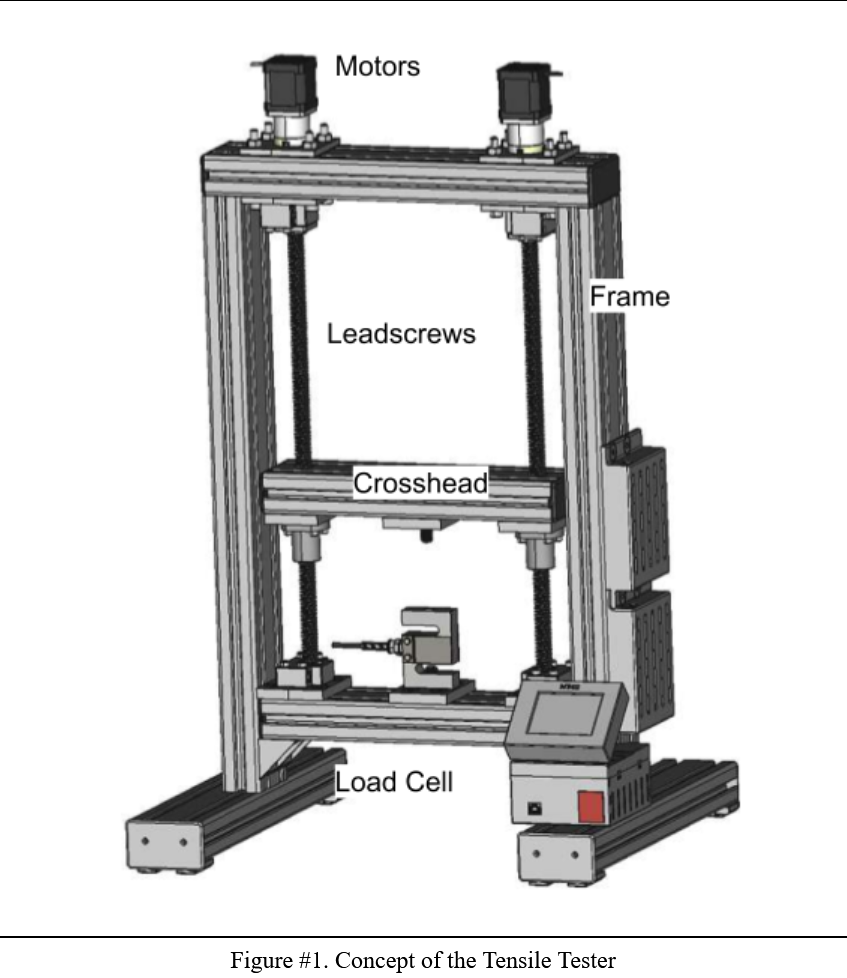
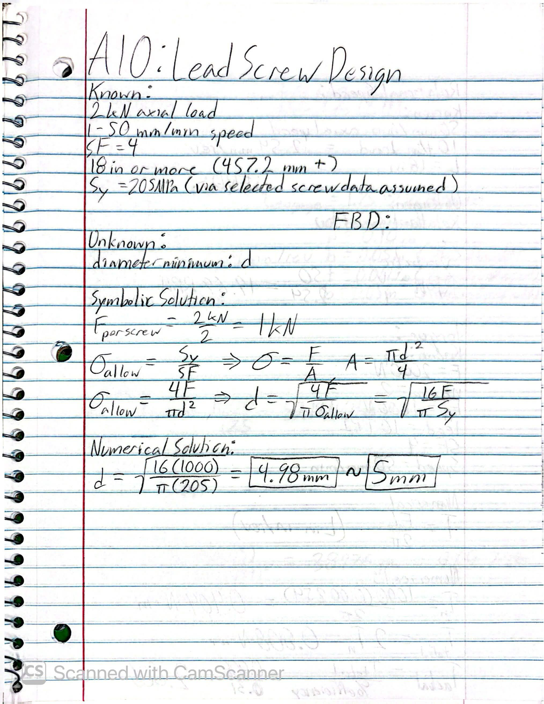
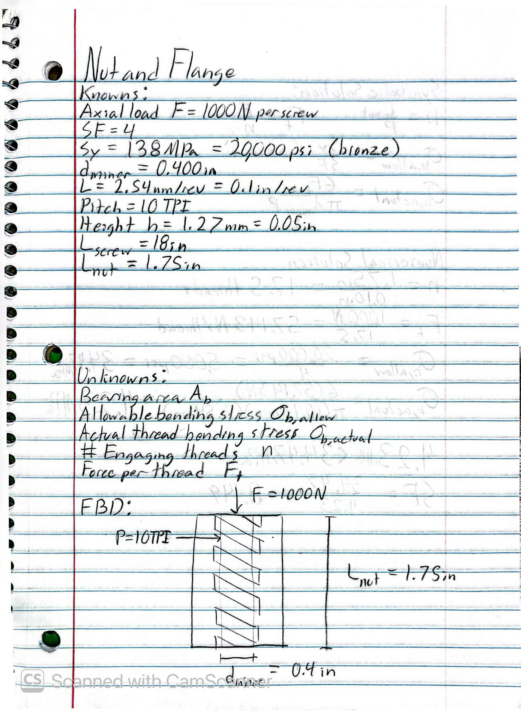
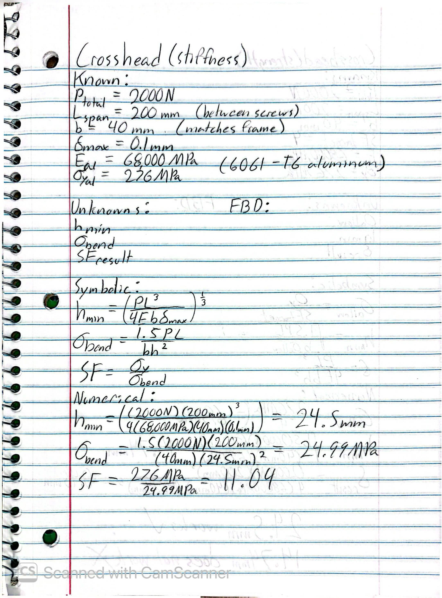
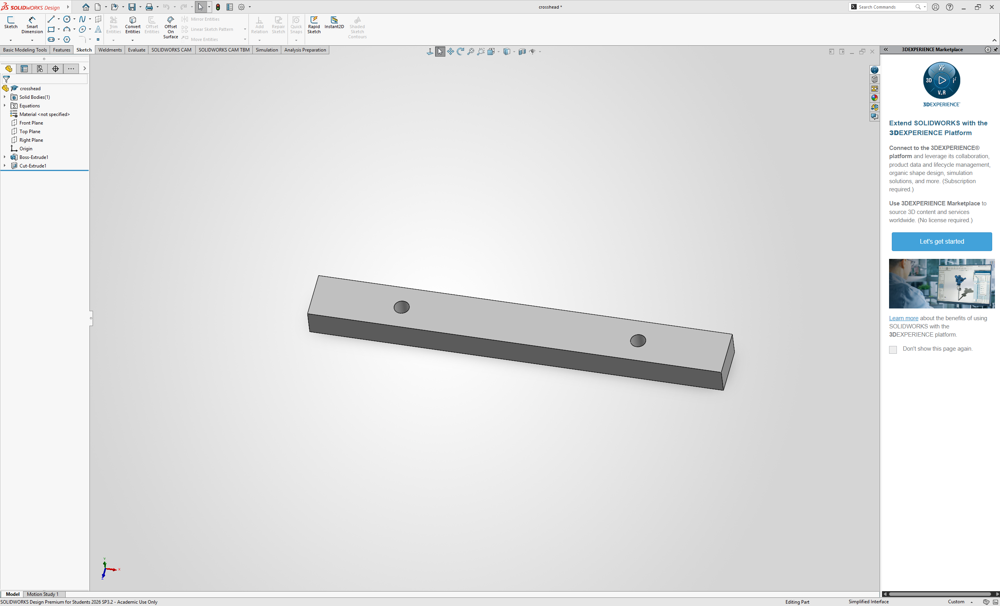
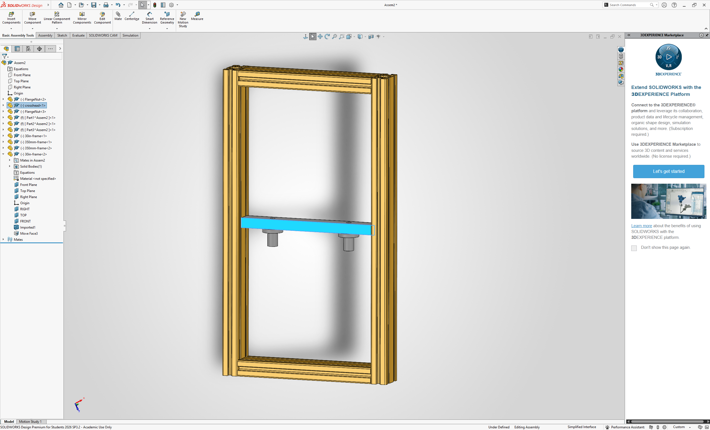
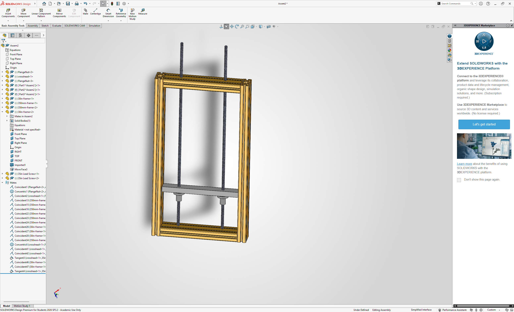
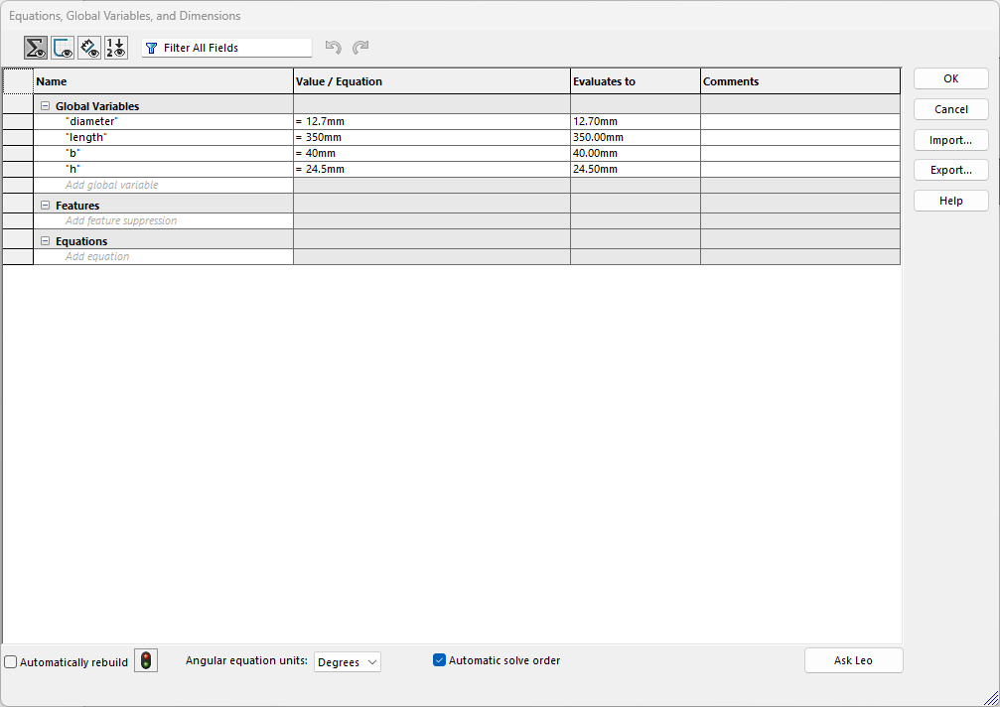

# A10 – Lead Screw Translating System

This project involves a group of two to three people to design a Tensile tester that utilizes a leadscrew system. Our group is made up of Jacob Huss, Ryan Seger, and Devin Adams and this will be the first half of the work on this system. The values we are designing and building are looking to achieve a "mechanically driven tensile tester capable of applying up to 2 kN axial tensile load with a controllable crosshead speed from 1 to 50 mm/min". Below is the example for what type of system we are targeting.

## **<u>Part 1: Leadscrew Minimum Diameter</u>**

For this section, we are calculating the expected minimum diameter for the leadscrew. Two leadscrews will be used with a safety factor of 4. The range of rotational speed given the linear speed will be calculated and then using an axial stress of 2kN of torque we will select properly fitting leadscrews from McMaster's website(both are to the same specification).

## **<u>Part 2: Select a Nut and Flange</u>**

At this point in the assignment, the flange nut that will complement the leadscrew is next. It must be made of bronze and fit the selected leadscrew threads-wise. It must also be able to support the bending stress it will encounter during operation, and have its safety factor calculated during operation

## **<u>Part 3: Design the Crosshead</u>**

Finally, the design of the crosshead is calculated. A proper length found with research, as well as minimum strength, (based on deflection of 0.1mm) and minimum base size will be based on a stress/strength analysis to determine the size and material the crosshead will be made of. Below is the calculations used to figure these variables. The end result below was made using aluminum.

## __Tabulating Costs__
| Item Number | Quantity | Name | Cost/Item | Cost | Purchase Link |
|:-----------:|:--------:|:-----|----------:|-----:|:-------------:|
| 98980A370 | 1 | 304 Stainless Steel Precision Acme Lead Screw, 1/2"-10, 6 ft | $127.10 | $127.10 | [McMaster-Carr](https://www.mcmaster.com/98980A370/) |
| 97790A110 | 2 | Precision Acme Flange Nut, 1/2"-10, 932 Bronze | $178.60 | $357.2 | [McMaster-Carr](https://www.mcmaster.com/97790A110/) |
| 804T48 | 1 | Frame: Rectangle, 40 Series, Smooth, Double, 3 m, 80 mm x 40 mm | $264.97 | $264.97 | [Grainger]([Link here](https://www.grainger.com/product/80-20-T-Slot-Framing-System-Rectangle-804T48) |
| | | | **Total Cost** | **$749.27** | |

## __Parametric Modeling__
Working with the screws, crosshead and bearings were long, but once the lengths of all of the parts were set properly, it fit together nicely. Both Devin and Ryan worked a bit on this, Devin figured out how to cut the pieces to size and ryan assembled the frame assembly

## __Parametric Equations__

## __Lessons Learned__

This project was tedious, thankfully the group system lightened the stress a bit. The instructions and layout of the resources section made figuring out how to select parts for the project difficult during the first couple hours of the project when we all first got together. Eventually we figured it out and got resources from the McMaster website. We had to rework the nut/flange section after making a mistake on some of the values, which we crosschecked later and realized the problem. Luckily it was caught relatively quickly before it affected any more of the project. CAD modelling and getting the screws to go in the right places was a pain. we eventually got it to work but it took some time selecting the right part of the screw and threads. It was interesting learing about how to make a table for the github page, rather than making an excel sheet and copying an image of it over to the directory to show. This project in total took 8 hours to complete

**<u>Files & Parametrics</u>**

[Flange Nut 3D](FlangeNut.SLDPRT)

[Lead Screw 3D](LeadScrew.SLDPRT)

[Final Assembly](Assem2.SLDASM)

