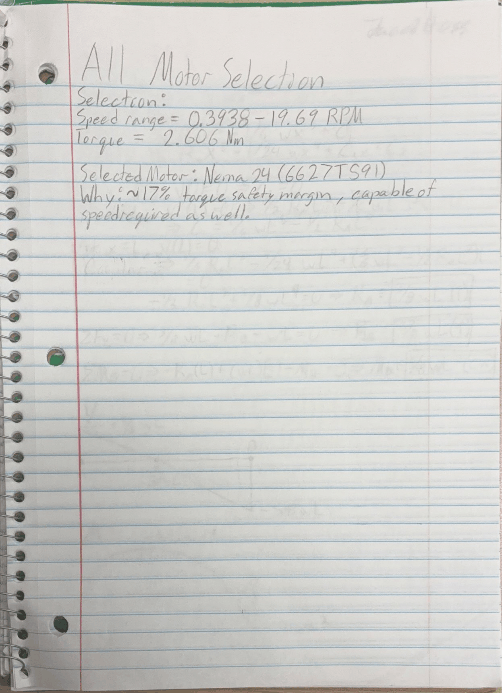
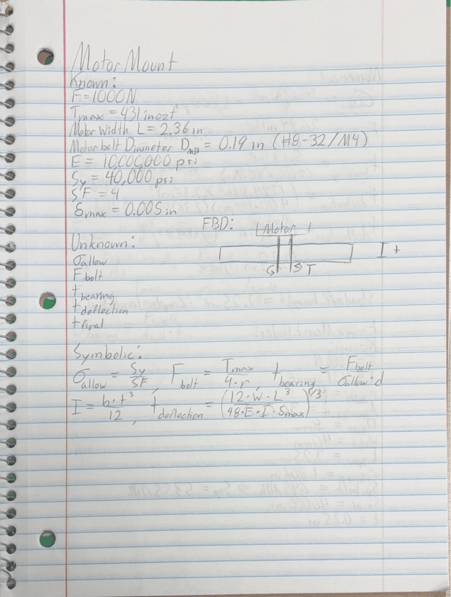
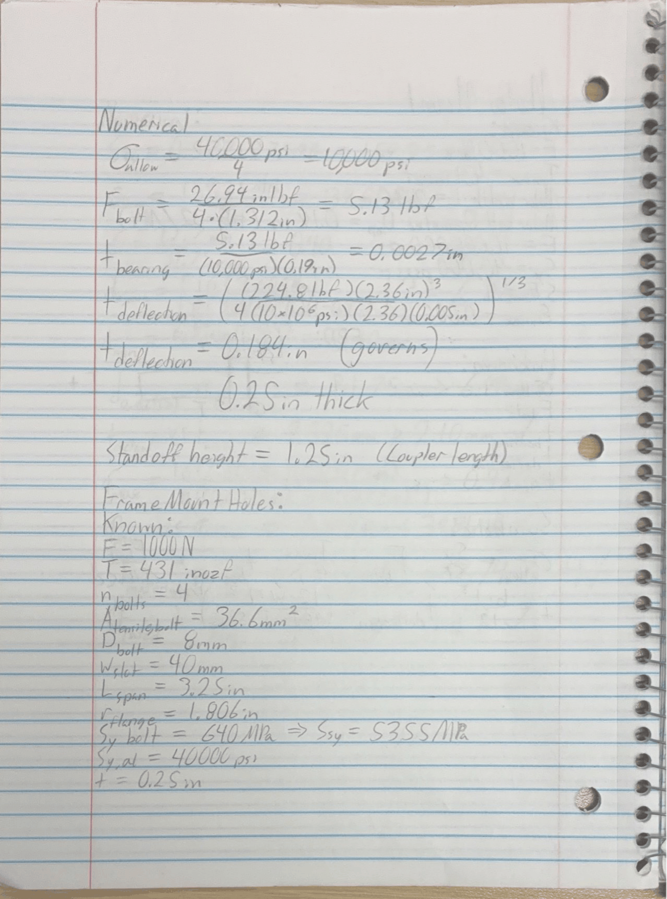
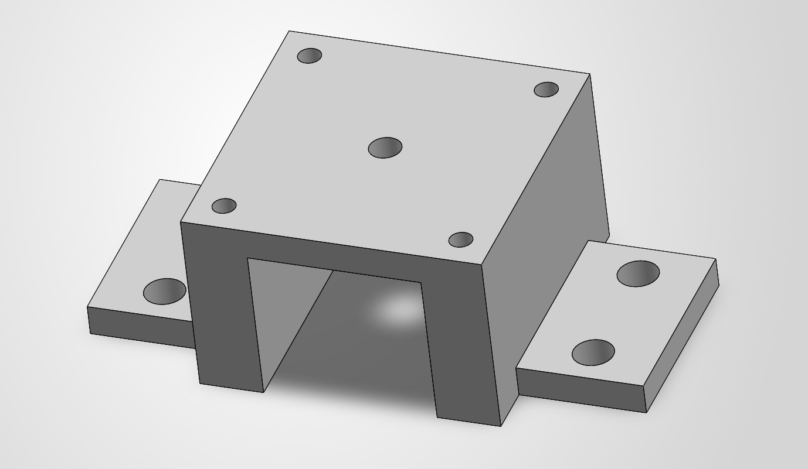
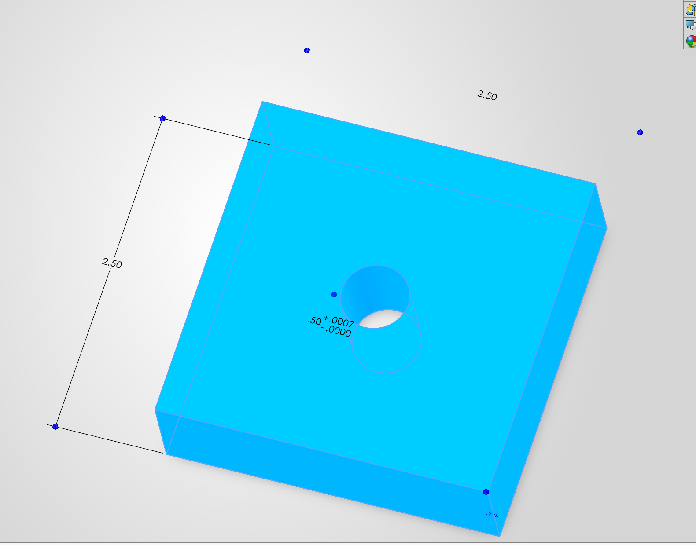
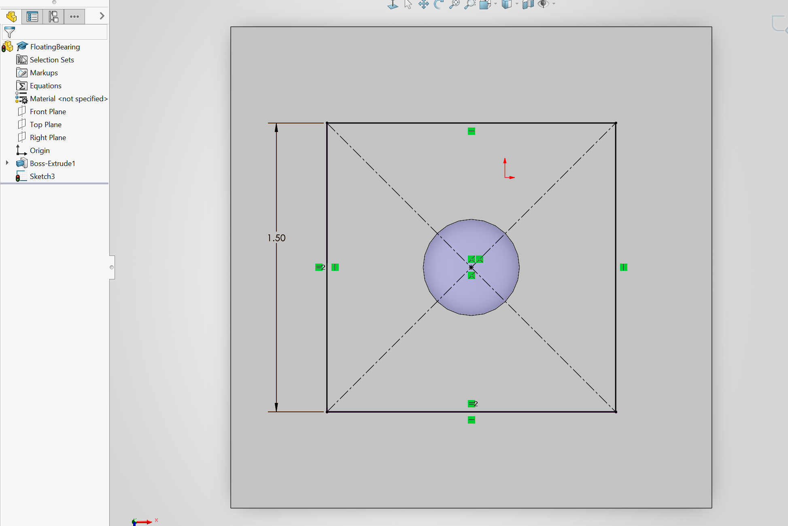
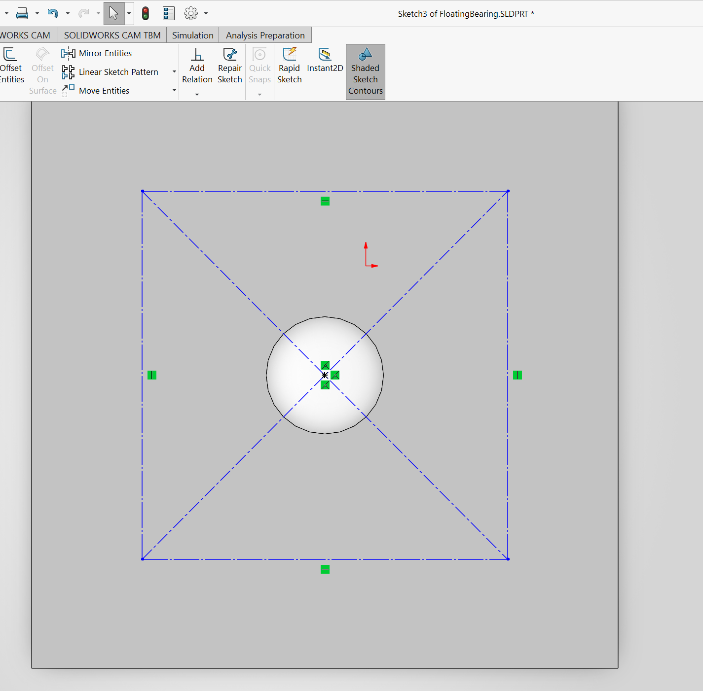
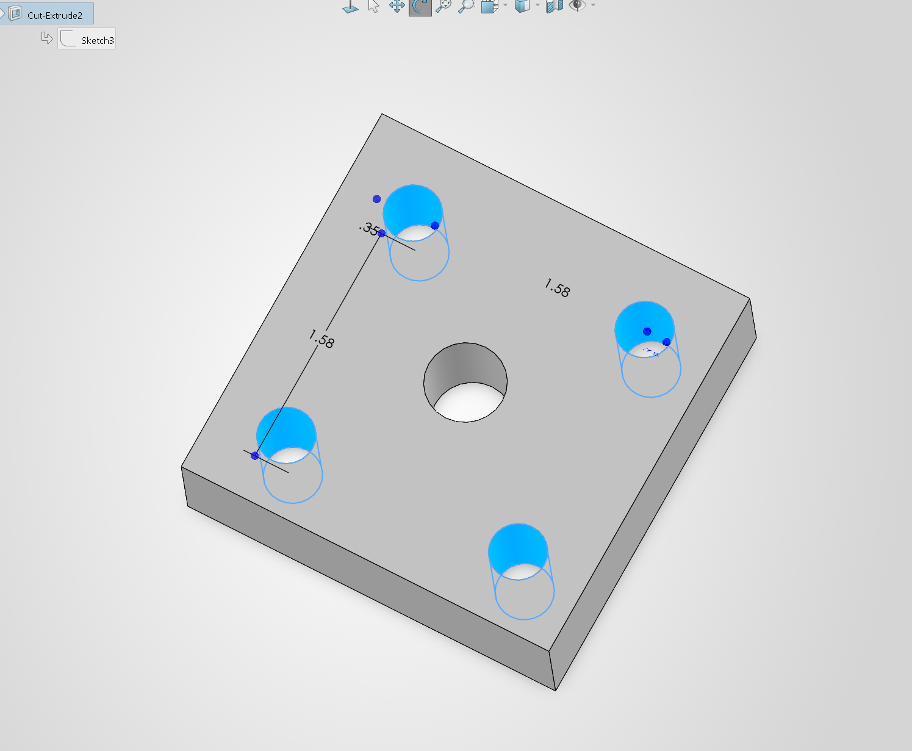

# A11 – Motor Selection

This is the second portion of our group development of a tensile testing lead screw system. During this section, the development of the motorized drive and structural integration for the 2 kN tensile tester is the primary focus. To achieve that a motor will be selected that aligns with our goals, and an analysis of the frame and clamp design/stability will be conducted to ensure it's safety factors are within specification. It will ensure that the crosshead moves accordingly under controlled torque and speed all while maintaining a precise load alignment. 

## **<u>Part 1: Motor Selection and Attachments (Jacob)</u>**

For the first part of this portion, utilizing the speed and torque requirements from the previous assignment we chose a motor to use, which ended up being a stepper type motor. After this choice we created a motor mounting bracket for the motor to attach to, which is pictured below. It maintains its alignment with the rest of the system and stays within its clearances and tolerances regarding deflection. For the thickness on the first section of this part, the calculated number was rounded up to 1/4 inch. Math was then done to validate the safety factors of the couplers along with the frame mounting holes for the motor mount.

## **<u>Part 2: Analyze and design a Frame</u>**

## **<u>Part 3: Design Floating Bearing Mount</u>**

## __Bill of Materials and Labor Costs__

| Item Number | Quantity | Name | Cost/Item | Cost | Purchase Link |
|:-----------:|:--------:|:-----|----------:|-----:|:-------------:|
| 98980A370 | 1 | 304 Stainless Steel Precision Acme Lead Screw, 1/2"-10, 6 ft | $127.10 | $127.10 | [McMaster-Carr](https://www.mcmaster.com/98980A370/) |
| 97790A110 | 2 | Precision Acme Flange Nut, 1/2"-10, 932 Bronze | $178.60 | $357.2 | [McMaster-Carr](https://www.mcmaster.com/97790A110/) |
| 804T48 | 1 | Frame: Rectangle, 40 Series, Smooth, Double, 3 m, 40 mm x 40 mm | $115.67 | $115.67 | [Grainger](https://www.grainger.com/product/80-20-T-Slot-Framing-System-Square-804TA8) |
|  6627T591  | 1 | Stepper Motor with Square Body | $152.00 | $152.00 | [McMaster-Carr](https://www.mcmaster.com/6627T591/) |
|  6208K565  | 1 | Clamping Precision Flexible Shaft Coupling | $102.50 | $102.50 | [McMaster-Carr]([https://www.mcmaster.com/6208K565/]) |
| | | | **Total Cost** | **$854.47** | |

| Person | Hours Worked | Cost/Hour | Cost |
|:-----------:|:--------:|:-----:|:----------:|
| Devin | 3 | 35 | 105 |
| Jacob | 4 | 35 | 140 |
| Ryan | 3 | 35 | 105 |
| | | **Total Cost** | **$350** |

| Final Cost: |
|:----:|
| $1,204.47 |

## __Lessons Learned__ Ryan/Devin/Jacob

We learned how to change the length of the frame, 

**<u>Files & Parametrics</u>**

[Motor Mount](A11MotorMountCAD.SLDPRT)
[Floating Bearing Mount](FloatingBearing.SLDPRT)

